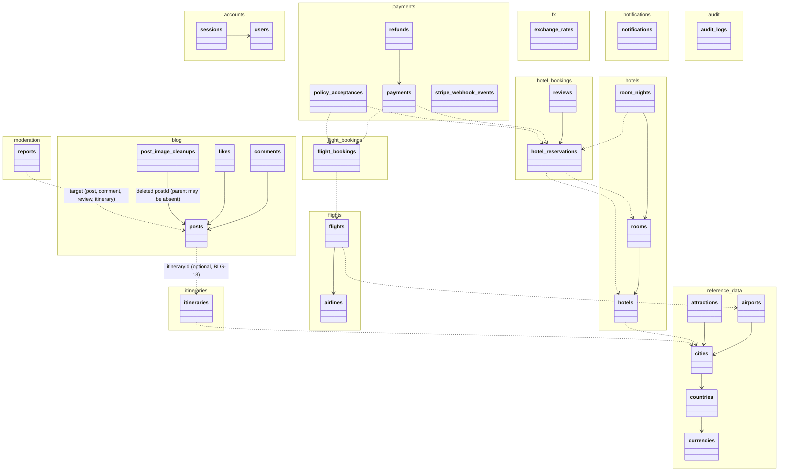
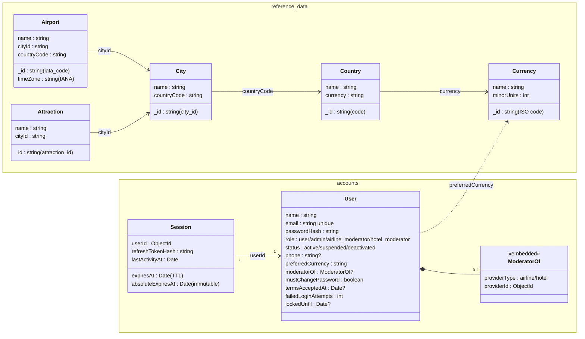
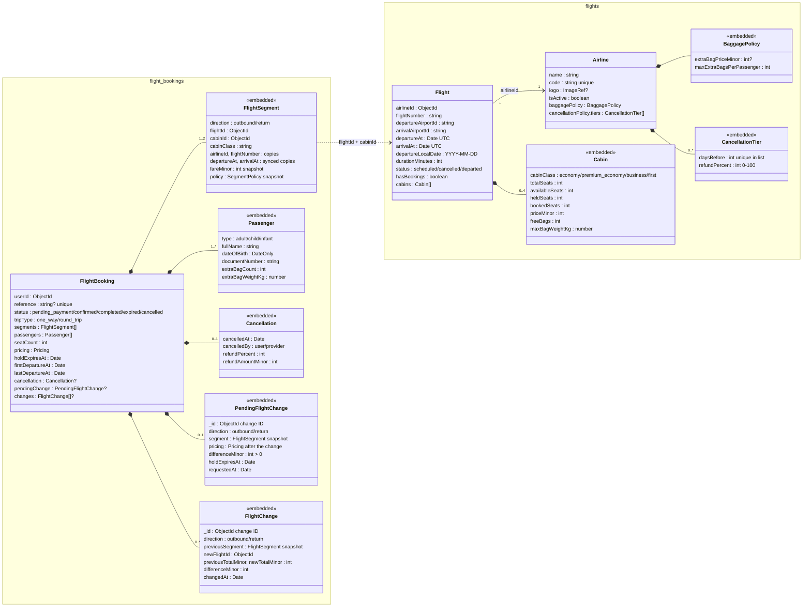
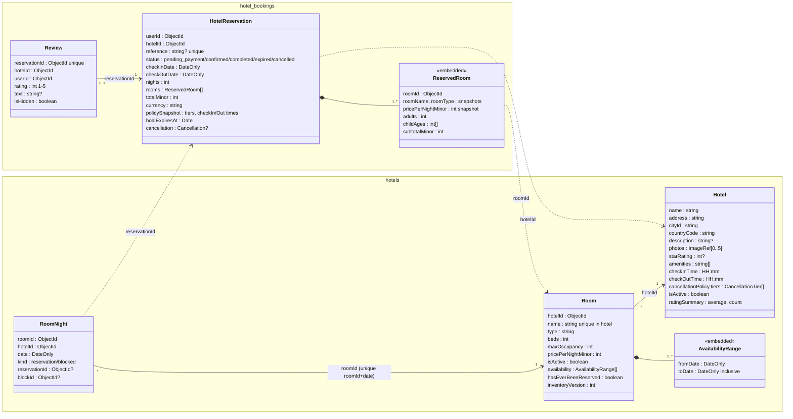
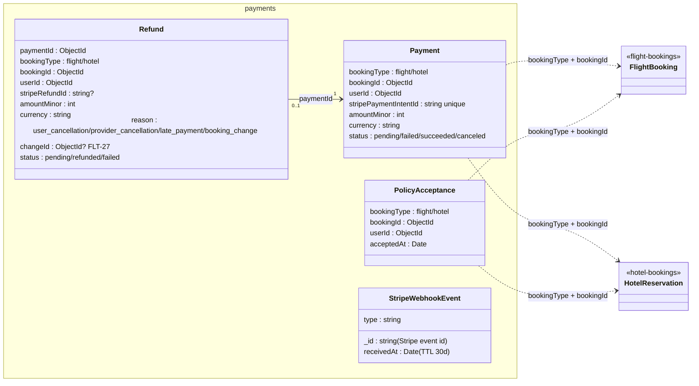
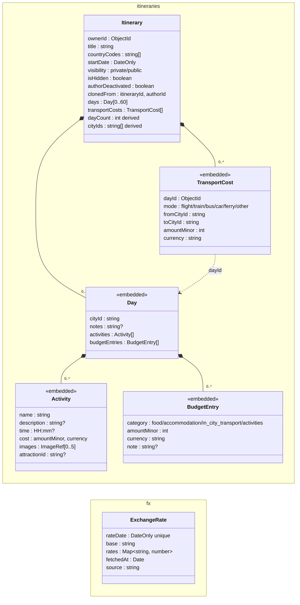
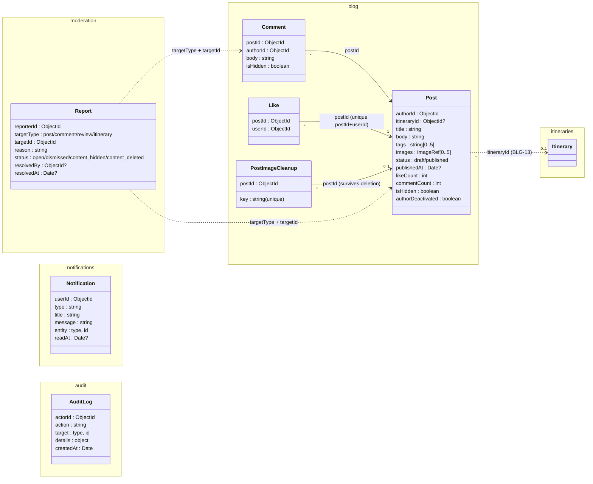

# Class Diagrams — Travel Platform

Generated from `data-model.md`. If they disagree, `data-model.md` wins.

**How to read them**

- Each yellow box is a module; classes inside it are the collections that module owns.
- **Filled diamond (composition) = embedded.** The child lives inside the parent document and is deleted with it.
- **Solid arrow = reference by ID inside the same module.**
- **Dashed arrow = reference by ID to another module's collection.** Only that module's service may read it.
- `<<embedded>>` marks subdocuments, not collections. Enum values are written `a/b/c`.
- Rendered SVGs are in `diagrams/` next to each `.mmd` source.

## Overview

## Accounts Reference

## Flights

## Hotels

## Payments

## Itineraries Fx

## Community

